# devops-cicd-project

End-to-end CI/CD automation for a Python Flask app: **GitHub Actions** (test, build, push) -> **Docker Hub** -> **Kubernetes (Minikube)** deployed with **Helm/kubectl**.

> Platform note: this project was built on **macOS**. Every Linux command in the assignment has a macOS equivalent in [Section 1](#1-linux--macos-administration-task-1). Replace `YOUR_DOCKERHUB_USERNAME` and `YOUR_GITHUB_USERNAME` with your own values.

## Contents
1. [Linux / macOS administration](#1-linux--macos-administration-task-1)
2. [Git and GitHub workflow](#2-git-and-github-task-2)
3. [Flask application](#3-flask-application-task-3)
4. [Docker](#4-docker-task-4)
5. [GitHub Actions CI/CD](#5-github-actions-cicd-task-5)
6. [Kubernetes](#6-kubernetes-task-6)
7. [CI/CD integration and architecture](#7-cicd-integration-task-7)
8. [Bonus tasks](#8-bonus-tasks)
9. [Troubleshooting and errors](#9-troubleshooting-and-errors-encountered)
10. [Viva Q&A](#10-viva-qa)
11. [Deliverables checklist](#11-deliverables-checklist)

## Repository structure

```text
devops-cicd-project/
├── app/                  app.py, requirements.txt, test_app.py
├── docker/               Dockerfile, .dockerignore
├── kubernetes/           namespace, deployment, service, configmap (+ hpa, staging ns, secret example)
├── helm/devops-app/      Helm chart (same resources, parameterised)
├── scripts/              system-monitor.sh, deploy-local.sh
├── logs/                 generated monitoring logs (git-ignored)
├── .github/workflows/    ci-cd.yml (CI), deploy.yml (CD)
├── .gitignore  .dockerignore
└── README.md
```

---

## 1. Linux / macOS administration (Task 1)

### Project setup
```bash
mkdir devops-project && cd devops-project
mkdir app docker kubernetes scripts logs
```
(In this repo the project directory is `devops-cicd-project`, which contains the same five directories.)

**User `devops-student`**

| Linux | macOS equivalent |
|---|---|
| `sudo useradd -m devops-student` | `sudo sysadminctl -addUser devops-student -fullName "DevOps Student" -password -` (prompts for a password) |
| `id devops-student` | `id devops-student` |
| `sudo userdel -r devops-student` | `sudo sysadminctl -deleteUser devops-student` |

macOS uses Directory Services instead of `/etc/passwd`, so `sysadminctl` replaces `useradd`. The user is only needed to practise ownership/permissions; the project itself does not depend on it.

### Command mapping

| Task | Linux | macOS | What it tells you |
|---|---|---|---|
| Running processes | `ps aux`, `top` | `ps aux`, `top -o cpu` | PID, owner, CPU/memory per process |
| Disk usage | `df -h`, `du -sh *` | `df -h`, `du -sh *` | Free/used space per filesystem |
| Memory usage | `free -h` | `vm_stat`, `memory_pressure`, `top -l 1 \| grep PhysMem` | RAM used/free (macOS counts reclaimable cache separately) |
| Listening ports | `ss -tulpn` | `lsof -iTCP -sTCP:LISTEN -P -n` or `netstat -an \| grep LISTEN` | Which ports are open and which process owns them |
| Which process uses port 5000 | `ss -tulpn \| grep :5000` | `lsof -i :5000` | Owner PID of the port (kill with `kill <PID>`) |
| System logs | `journalctl -xe`, `journalctl -u docker` | `log show --last 10m`, `log stream --predicate 'process == "Docker"'` | Recent system/service messages (macOS uses unified logging) |
| Install Git | `sudo apt install git` | `xcode-select --install` or `brew install git` | |
| Install Docker | `sudo apt install docker.io` | Docker Desktop (or `brew install --cask docker`) | |

Verify installs:
```bash
git --version
docker --version && docker run --rm hello-world
kubectl version --client
minikube version
helm version
```

### Permissions practice (`chmod` / `chown`)
```bash
touch demo.txt
ls -l demo.txt                  # -rw-r--r--  owner can write, others read
chmod 600 demo.txt              # owner read/write only
chmod u+x scripts/system-monitor.sh   # make script executable
chmod -R 755 scripts            # rwx for owner, r-x for group/others
sudo chown -R devops-student:staff logs   # change owner (macOS default group: staff; Linux: devops-student)
ls -l logs
```
Permission digits: read=4, write=2, execute=1; they are given for owner/group/others (e.g. `755` = `rwxr-xr-x`).

### Bash script: `scripts/system-monitor.sh`
Displays date/time, hostname, CPU, memory, disk and uptime, and appends the output to `logs/system-monitor.log`. It detects macOS (`top -l`, `vm_stat`, `sysctl`) versus Linux (`top -bn1`, `free -h`).
```bash
chmod +x scripts/system-monitor.sh
./scripts/system-monitor.sh
cat logs/system-monitor.log
```
Sample output:
```text
Date/Time : 2026-11-10 22:29:49 CST
Hostname  : Balachanders-MacBook-Pro.local
CPU Usage : 3.74% user, 3.45% sys, 92.80% idle
Memory    : Total: 24.00 GB | Used: 10.24 GB (42.7%) | Free/Reclaimable: 8.19 GB
Disk Usage (/): ... 926Gi size, 2% used
Uptime    : 22:29  up 31 days, 10 hrs, 2 users, load averages: 1.46 2.27 2.14
```

---

## 2. Git and GitHub (Task 2)

Public repository: `devops-cicd-project`.

Authenticate with a Personal Access Token (never commit it) stored in the macOS Keychain:
```bash
git config --global user.name "Your Name"
git config --global user.email "you@example.com"
git config --global credential.helper osxkeychain
git clone https://github.com/YOUR_GITHUB_USERNAME/devops-cicd-project.git   # prompts for username + PAT once
```

Branch workflow:
```bash
git checkout main                       # main branch (created by GitHub)
git checkout -b develop                 # develop branch
git push -u origin develop
git checkout -b feature/flask-app develop   # feature branch
# ... work and commit with meaningful messages ...
git push -u origin feature/flask-app
# GitHub: open Pull Request  feature/flask-app -> develop, review, merge
git checkout develop && git pull
# GitHub: open PR develop -> main to release
```
Commit message convention used: `type: short description` (e.g. `feat: add /health endpoint`, `ci: add GitHub Actions pipeline`, `docs: add README`).

---

## 3. Flask application (Task 3)

- `app/app.py` - Flask app on port **5000**. `/` returns `Welcome to DevOps CI/CD Project`; `/health` returns JSON.
- `app/requirements.txt` - pinned Flask, gunicorn (production server), pytest.
- `app/test_app.py` - tests for `/`, `/health` and 404 handling.

```bash
cd app
python3 -m venv .venv && source .venv/bin/activate
pip install -r requirements.txt
python -m pytest -v        # run tests
python app.py              # run locally
curl http://localhost:5000/
curl http://localhost:5000/health
# {"application":"devops-project","status":"healthy"}
```
> macOS note: on newer macOS versions AirPlay Receiver uses port 5000. If `curl` returns 403 from `AirTunes`, disable it in System Settings -> General -> AirDrop & Handoff -> AirPlay Receiver, or map another host port (e.g. `-p 5001:5000`).

---

## 4. Docker (Task 4)

`docker/Dockerfile` is a **multi-stage build**: stage 1 installs dependencies; stage 2 copies only the installed packages and the app into a clean `python:3.12-slim` image, runs as a non-root user, exposes 5000 and starts gunicorn. `docker/.dockerignore` (and an identical root `.dockerignore`, because Docker reads the file from the build-context root) keeps git data, docs and manifests out of the image.

```bash
# Build (run from the repo root)
docker build -f docker/Dockerfile -t YOUR_DOCKERHUB_USERNAME/devops-project:latest .

# Run, mapping host 5000 -> container 5000
docker run -d --name devops-app -p 5000:5000 YOUR_DOCKERHUB_USERNAME/devops-project:latest

# Test
curl http://localhost:5000/
curl http://localhost:5000/health

# Inspect and logs
docker ps
docker inspect devops-app
docker logs devops-app

# Stop and remove
docker stop devops-app && docker rm devops-app

# Push to Docker Hub
docker login
docker push YOUR_DOCKERHUB_USERNAME/devops-project:latest
```
Docker Hub image: `https://hub.docker.com/r/YOUR_DOCKERHUB_USERNAME/devops-project`

---

## 5. GitHub Actions CI/CD (Task 5)

Workflow: `.github/workflows/ci-cd.yml`. Triggers: push to `main`, `develop`, `feature/**`; pull requests to `main`/`develop`.

| Stage | Where | Detail |
|---|---|---|
| 1 Checkout | `actions/checkout@v4` | Fetches the repo |
| 2 Setup | `actions/setup-python@v5` | Python 3.12, pip cache, `pip install -r app/requirements.txt` |
| 3 Testing | `pytest` | Job `test`; a failure stops the pipeline |
| 4 Docker build | `docker/build-push-action@v6` | Tagged with the **full git commit SHA** (and `latest` on `main`) |
| 5 Docker push | `docker/login-action@v3` | Logs in with secrets, pushes image |

`build-and-push` uses `needs: test`, so a failed test means no image is built or pushed. Pull requests only run tests (no push).

### Required GitHub Secrets
Repository -> Settings -> Secrets and variables -> Actions -> New repository secret:

| Secret | Value |
|---|---|
| `DOCKERHUB_USERNAME` | Your Docker Hub username |
| `DOCKERHUB_TOKEN` | Docker Hub access token (Account Settings -> Security -> New Access Token, Read & Write) |

### Security measures
- No credentials appear in any file; the workflow reads `${{ secrets.* }}`. GitHub masks secret values in logs.
- `permissions: contents: read` gives the workflow a minimal `GITHUB_TOKEN`.
- Third-party actions are pinned to major version tags (`@v4`, `@v5`, `@v3`, `@v6`). For stricter supply-chain security, replace each tag with the full commit SHA of that release (e.g. `uses: actions/checkout@<40-char-sha> # v4`).
- `.gitignore` excludes `.env`, keys and kubeconfig files.

Screenshot to capture: the Actions tab showing a green run (and one red run if you want to demonstrate a failing test stopping the pipeline).

---

## 6. Kubernetes (Task 6)

### Local cluster
```bash
brew install minikube kubectl helm      # macOS (Docker Desktop must be running)
minikube start --driver=docker
kubectl get nodes
```

### Resources (`kubernetes/`)
| File | Resource | Notes |
|---|---|---|
| `namespace.yaml` | Namespace `devops-app` | |
| `configmap.yaml` | ConfigMap `devops-app-config` | `APP_ENV`, `LOG_LEVEL` injected as env vars |
| `deployment.yaml` | Deployment `devops-app` | 2 replicas, port 5000, CPU/memory requests+limits, liveness + readiness probes on `/health`, rolling update (`maxUnavailable: 0`, `maxSurge: 1`) |
| `service.yaml` | Service `devops-app-service` | `NodePort`, `targetPort: 5000`, `nodePort: 30007` |

Deploy with raw manifests (first implementation):
```bash
# replace the image placeholder first
sed -i '' 's/YOUR_DOCKERHUB_USERNAME/<your-user>/' kubernetes/deployment.yaml   # macOS sed; on Linux use: sed -i
kubectl apply -f kubernetes/namespace.yaml
kubectl apply -f kubernetes/configmap.yaml
kubectl apply -f kubernetes/deployment.yaml
kubectl apply -f kubernetes/service.yaml
```

Access the app from outside the cluster (the Minikube Docker driver on macOS does not expose the node IP directly):
```bash
minikube service devops-app-service -n devops-app --url     # keep the terminal open
curl <printed-url>/health
# alternative: kubectl port-forward -n devops-app svc/devops-app-service 8080:80
```

### Kubernetes operations
```bash
kubectl get pods -n devops-app                     # list pods
kubectl get deployments -n devops-app              # list deployments
kubectl get services -n devops-app                 # list services
kubectl logs deployment/devops-app -n devops-app   # application logs
kubectl describe pod <pod-name> -n devops-app      # describe a pod

kubectl scale deployment devops-app --replicas=3 -n devops-app    # scale 2 -> 3
kubectl get pods -n devops-app -w

# Rolling update: deploy a new image tag
kubectl set image deployment/devops-app devops-app=YOUR_DOCKERHUB_USERNAME/devops-project:<new-tag> -n devops-app
kubectl rollout status deployment/devops-app -n devops-app
kubectl rollout history deployment/devops-app -n devops-app

# Roll back
kubectl rollout undo deployment/devops-app -n devops-app
kubectl rollout undo deployment/devops-app --to-revision=1 -n devops-app

# Delete a pod and observe self-healing
kubectl delete pod <pod-name> -n devops-app
kubectl get pods -n devops-app -w     # the ReplicaSet immediately creates a replacement
```
**Observation:** when a pod is deleted, the Deployment's ReplicaSet notices the actual count is below the desired count and starts a new pod with a new name; traffic continues through the other replicas.

### Health checks
Both probes call `GET /health` on port 5000.
- **Liveness**: failing probe -> kubelet restarts the container.
- **Readiness**: failing probe -> pod is removed from the Service endpoints (no traffic) but not restarted.

---

## 7. CI/CD integration (Task 7)

```mermaid
flowchart LR
  dev[Developer pushes code] --> gh[GitHub repo]
  gh --> ci[GitHub Actions CI - hosted runner]
  ci --> test[pytest]
  test --> build[Docker build, tag = commit SHA]
  build --> hub[Docker Hub]
  hub --> cd[CD workflow - self-hosted runner on the Mac]
  cd --> helm[helm upgrade --install]
  helm --> mk[Minikube namespace devops-app]
  mk --> svc[NodePort Service]
  svc --> user[User browser or curl]
```



**CI (cloud)** - `ci-cd.yml` runs on GitHub-hosted Ubuntu runners: install, test, build, push.

**CD (local, secure)** - Minikube runs on a laptop and is not reachable from GitHub's cloud, and cluster credentials must never be put in the repo or logs. So the CD stage runs **on the local machine**:

1. `scripts/deploy-local.sh` - manual CD with Helm:
   ```bash
   export DOCKERHUB_USERNAME=<your-user>
   ./scripts/deploy-local.sh production <commit-sha>     # or: staging
   ```
2. `.github/workflows/deploy.yml` - the same deployment as a GitHub Actions workflow that runs on a **self-hosted runner** on the Mac (labels `self-hosted, macOS, minikube`). It triggers after the CI workflow succeeds on `main`, or manually via *Run workflow*. The kubeconfig stays in `~/.kube/config` on the Mac and is never uploaded.

   Register the runner: Repository -> Settings -> Actions -> Runners -> New self-hosted runner (macOS), follow the commands shown, and add the custom label `minikube` when running `./config.sh`.

Helm chart (`helm/devops-app`): `values.yaml` defaults, `values-staging.yaml` overrides; `--set image.tag=<sha>` pins the exact version built by CI.
```bash
helm lint helm/devops-app
helm template devops-app helm/devops-app | kubectl apply --dry-run=client -f -
helm history devops-app -n devops-app
helm rollback devops-app 1 -n devops-app     # automated-style rollback
```

**Complete flow:** change code -> push -> Actions runs tests -> builds image tagged with the commit SHA -> pushes to Docker Hub -> CD (self-hosted runner or `deploy-local.sh`) runs `helm upgrade` with that SHA -> Kubernetes performs a rolling update -> the new version is served through the NodePort Service.

---

## 8. Bonus tasks

| Bonus | Where |
|---|---|
| ConfigMap | `kubernetes/configmap.yaml`, `helm/.../templates/configmap.yaml` |
| Secret | `kubernetes/secret.example.yaml` (example only; create real ones with `kubectl create secret generic devops-app-secret -n devops-app --from-literal=APP_SECRET_KEY=$(openssl rand -hex 16)`) |
| HPA | `kubernetes/hpa.yaml`; Helm: `--set autoscaling.enabled=true`. Needs `minikube addons enable metrics-server` |
| Staging namespace | `kubernetes/namespace-staging.yaml` (`devops-app-staging`), Helm `values-staging.yaml`, `deploy-local.sh staging` |
| Resource requests/limits | `deployment.yaml` (100m/128Mi requests, 250m/256Mi limits) |
| Image versioning | Images tagged with the commit SHA; `latest` only on `main` |
| GitHub Actions caching | pip cache (`setup-python`) and Docker layer cache (`cache-from/to: type=gha`) |
| Separate dev/prod workflows | `ci-cd.yml` for all branches; `deploy.yml` with `environment` input (production/staging) |
| Helm | `helm/devops-app` |
| Rollback documentation | Sections 6 and 7 (`kubectl rollout undo`, `helm rollback`) |

---

## 9. Troubleshooting and errors encountered

| Problem | Cause | Fix |
|---|---|---|
| `curl localhost:5000` returns 403 / `AirTunes` on macOS | macOS AirPlay Receiver uses port 5000 | Disable AirPlay Receiver or use `-p 5001:5000` |
| `Address already in use` | Another process owns the port | `lsof -i :5000`, then `kill <PID>` |
| `ImagePullBackOff` / `ErrImagePull` | Wrong image name/tag, or private image | `kubectl describe pod`; check the username/tag in the Deployment; make the Docker Hub repo public or add an `imagePullSecret` |
| `CrashLoopBackOff` | App exits on startup or liveness probe keeps failing | `kubectl logs <pod> --previous`, `kubectl describe pod` (Events, exit code), fix the app/command/probe path/resources |
| Pod `Running` but `0/1 READY` | Readiness probe failing | Check `/health` path and port; `kubectl describe pod` |
| `OOMKilled` | Memory limit too low | Increase `resources.limits.memory` |
| NodePort not reachable on macOS | Minikube Docker driver runs the node in a VM/container | `minikube service ... --url` or `kubectl port-forward` |
| HPA shows `<unknown>` | metrics-server missing | `minikube addons enable metrics-server` |
| Docker login fails in Actions | Wrong/missing secret | Re-create `DOCKERHUB_USERNAME`/`DOCKERHUB_TOKEN`; the token needs Read & Write |
| Workflow push rejected | PAT lacks `workflow` scope | Add the `workflow` scope to the classic PAT (or Workflows permission for fine-grained tokens) |
| Deploy job stays "Queued" | No self-hosted runner online | Start the runner (`./run.sh`) and check its labels |

> If a token is ever pasted into a terminal, chat or file, revoke it immediately in GitHub -> Settings -> Developer settings and create a new one.

---

## 10. Viva Q&A

**Git vs GitHub?** Git is the distributed version-control tool that runs locally; GitHub is a hosting service for Git repositories adding collaboration (pull requests, Actions, issues).

**Docker image vs container?** An image is a read-only template (layers: OS files, dependencies, app). A container is a running instance of an image with a writable layer and its own process/network namespace.

**CMD vs ENTRYPOINT?** `ENTRYPOINT` defines the fixed executable; `CMD` provides default arguments or the default command and is easily overridden by `docker run <image> <cmd>`. Used together, `CMD` supplies default arguments to `ENTRYPOINT`.

**Multi-stage build?** Several `FROM` stages in one Dockerfile; build tools/artifacts live in an early stage and only the needed output is copied into the final stage, giving smaller, safer images. This project's builder stage installs packages and the runtime stage copies them.

**Workflows, jobs, steps?** A workflow is a YAML automation in `.github/workflows`. It contains jobs (run in parallel unless `needs` is set), and each job is a sequence of steps (shell commands or actions) on one runner.

**Runners?** Machines that execute jobs: GitHub-hosted (ubuntu/windows/macos VMs) or self-hosted (your own machine, used here for local CD).

**GitHub Secrets?** Encrypted values stored per repo/org/environment, exposed to workflows only as `${{ secrets.NAME }}`, masked in logs, and not passed to workflows from forks.

**What happens when a test fails?** The step exits non-zero, the job fails, dependent jobs (`needs: test`) are skipped, so no image is built or pushed and the run is marked failed.

**Pod vs Deployment?** A Pod is the smallest unit (one or more containers) and is not self-healing. A Deployment manages ReplicaSets/Pods declaratively: desired replica count, rolling updates and rollbacks.

**What happens when a pod crashes?** The kubelet restarts the container (restart policy, with back-off); if the pod is deleted/lost, the ReplicaSet creates a new one to match the desired count.

**ClusterIP vs NodePort vs LoadBalancer?** ClusterIP: internal-only virtual IP (default). NodePort: ClusterIP plus a static port (30000-32767) on each node. LoadBalancer: NodePort plus an external cloud load balancer.

**Rolling update?** Pods are replaced gradually with the new version (controlled by `maxSurge`/`maxUnavailable`), keeping the app available. Readiness probes gate traffic to new pods.

**Rollback?** `kubectl rollout undo deployment/devops-app` (or `--to-revision=N`); with Helm, `helm rollback devops-app <revision>`.

**ConfigMap vs Secret?** Both inject configuration. ConfigMap holds non-sensitive plain-text data; Secret holds sensitive data (base64-encoded, can be encrypted at rest and access-controlled by RBAC).

**Liveness vs readiness?** Liveness: "is the container alive?" - failure restarts it. Readiness: "can it serve traffic?" - failure removes it from Service endpoints without a restart.

**Troubleshooting CrashLoopBackOff?** `kubectl get pods` -> `kubectl describe pod` (events, exit code, probe failures) -> `kubectl logs <pod> --previous` -> check image command/env/config, resource limits (OOMKilled), probe path/port -> fix and redeploy.

**Which process uses a port?** Linux: `ss -tulpn | grep :PORT` (or `lsof -i :PORT`). macOS: `lsof -i :PORT`.

**Disk and memory utilization?** Linux: `df -h`, `du -sh`, `free -h`. macOS: `df -h`, `vm_stat`, `memory_pressure`, `top -l 1`. Both are collected by `scripts/system-monitor.sh`.

---

## 11. Deliverables checklist

- [ ] GitHub repository URL: `https://github.com/YOUR_GITHUB_USERNAME/devops-cicd-project`
- [x] Flask source (`app/`)
- [x] Monitoring script (`scripts/system-monitor.sh`)
- [x] `Dockerfile` and `.dockerignore`
- [ ] Docker Hub image URL: `https://hub.docker.com/r/YOUR_DOCKERHUB_USERNAME/devops-project`
- [x] Workflow files (`.github/workflows/ci-cd.yml`, `deploy.yml`)
- [ ] Screenshots: successful GitHub Actions run
- [x] Kubernetes Namespace, Deployment, Service YAML
- [ ] Screenshots: running pods (`kubectl get pods -n devops-app`)
- [ ] Screenshots: app reachable in the browser/`curl` via the Service
- [x] README and architecture explanation
